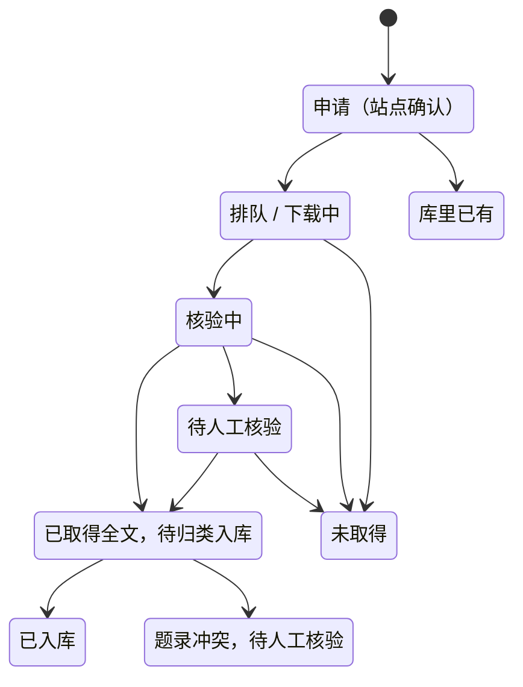

# 用户全文申请闭环：状态和边界

| 状态 | 来源字段 | 谁写 |
| --- | --- | --- |
| 排队、核验中、待处理、未取得 | 公共 job 的 `state`、`stage`，以及公共 paper 的 `fulltextStatus` | Worker 记录下载端领取、上传和核验结果；浏览器回写同一条本地申请。 |
| 待人工核验 / 人工核验未通过，可重新提交 | 公共 job 的 `reason` 为 `identity_hold` / `identity_hold_rejected` | Worker 是事实来源；浏览器只存两种已知原因，不转述任意服务端文字。 |
| 已取得、待归类入库 | 补录 paper 为 `available`，没有匹配的静态文献库题录 | Worker 确认可用；浏览器标待入库，不补猜主题。 |
| 已入库 | 已取得，且公开库中规范 DOI 与题名键同一；回写 `libraryState=ingested` 和静态 ID | owner 审批快照，构建提供静态题录；浏览器从该对象读归类和阅读详情。 |
| 库里已有 | 静态同篇已由 PDF 索引确认且现有链接可用，不需为本申请再取得补录全文 | 构建提供 PDF 索引，浏览器使用原有 `pdfDownloadUrl`；不新增下载入口。 |
| 题录冲突 | 已取得，但同 DOI 的公开题录都不能通过题名匹配 | 本地判定标人工复核；不替换静态题录、不把补录文件绑定到另一标题。 |

## 只读入库判定

`python3 scripts/request_loop.py --records FILE [--snapshot PATH] [--format json|md] [--out .local/NAME]` 接受题录数组或含 `papers` 数组的对象。先判断是否取得全文，再按同 DOI 同题、同 DOI 异题、异 DOI 同题、新题录的顺序判定。只有新且可取得的项给出归类建议；异 DOI 同题列候选 DOI，不自动合并。分类复用 `enrich_metadata.enrich_paper`，包括期刊别名、病例报告期刊规则、标签与人工覆盖。报告默认写 stdout；可选文件须位于本仓库 `.local/`，且不得覆盖已有文件。输入是调用者提供的公开投影，不联网，也不下载 PDF。

| 现有题名键 | 差异与选择 |
| --- | --- |
| `sync_public_library.title_key` | NFKC、casefold、合并空白；键也包含期刊，不适合仅凭题名提示跨 DOI 候选。 |
| `pdf_identity.title_key` | 为 PDF 绑定处理已知栏目前缀和大小写；保留实质标点，不能满足题录标点差异。 |
| `backfill_library_metadata.title_key` | **复用。** NFKC、小写、去 Unicode 标点和空白，保留实质词。浏览器与报告均沿用现有 DOI 兼容处理：去方括号栏目前缀、`ß → ss`、`ς → σ`。 |

前端只用 `doiTitleKey`：列表合并、下载链接的题录对应和申请记录不再对同一 DOI 得出不同结论。共享夹具验证内部连字符、弯引号、实质词差异及跨 DOI 仅提示。题录匹配**不是** PDF 身份校验；仍由站点决定全文是否可用，PDF 路由和权限不变。雷达、每日精选、已复用到动态列表的对象都不是快照，不能把申请标为已入库。

## 回写与运行边界

不改变请求键、原始申请时间、条数和裁剪规则。没有有效服务端结果就不写新状态。监听分片脚本的加载事件，以 `partsReady('library')` 确认文献库已合入后再补核对，不追加 API 请求。启动和打开弹窗逐条串行点查，最多十条，覆盖失败、需人工处理、核验与尚未入库的可用记录；「刷新全部状态」仍可主动查所有记录。

普通文献卡片仍显示「可下载」。只有申请记录和 DOI 检索的获取入口显示「库里已有」；过期申请表单若仍能提交，原处提示可直接下载，不发起请求。

实际更新快照、清单、哈希并发布仍由 owner 执行。快照继续遵守 `localAvailable=false`、`fulltextStatus=not_verified`；浏览器的入库状态不替代文件核验。

**不需要 Worker 的建议：** 将只读判定作为 owner 的批次核对附件；对可能重复及身份冲突保留人工裁定，每次借审核后的快照重新报告。

**需要 Worker 的建议：** 当前闭环不需要改 Worker。如果以后要求跨浏览器同步、待入库的服务端状态或未发布之前就展示正式归类，可另议一个只读公共字段（如 `catalogStage` 与经审核的 `catalogPaperId`）；发布端以版本化快照确认后才回写。它不应返回内部路径、PDF 数据或令牌，也不应改变下载鉴权。
