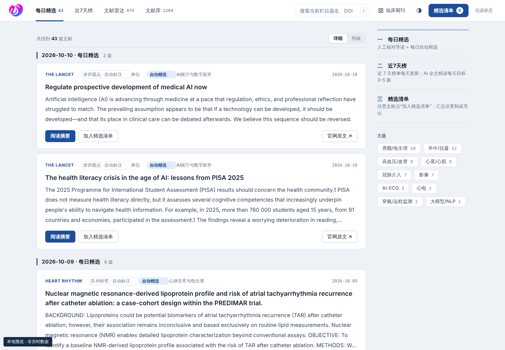
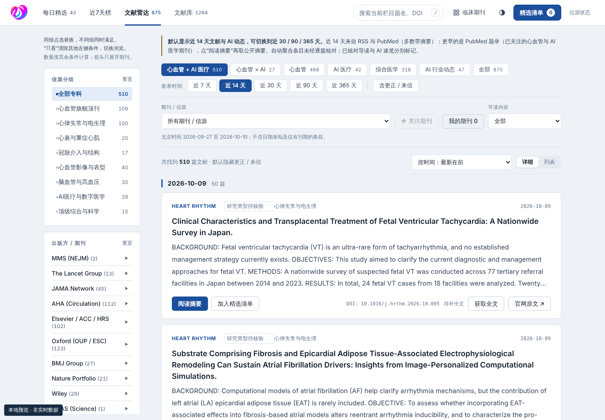
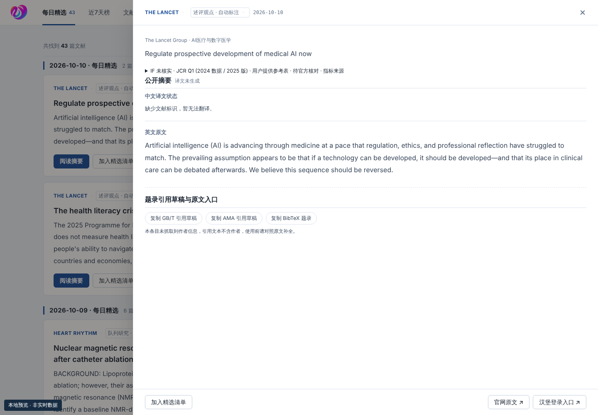
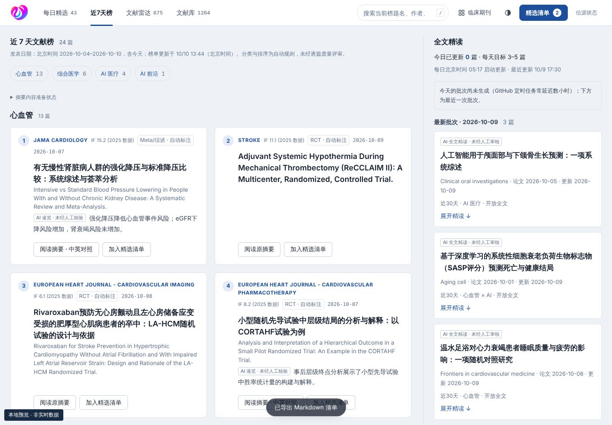
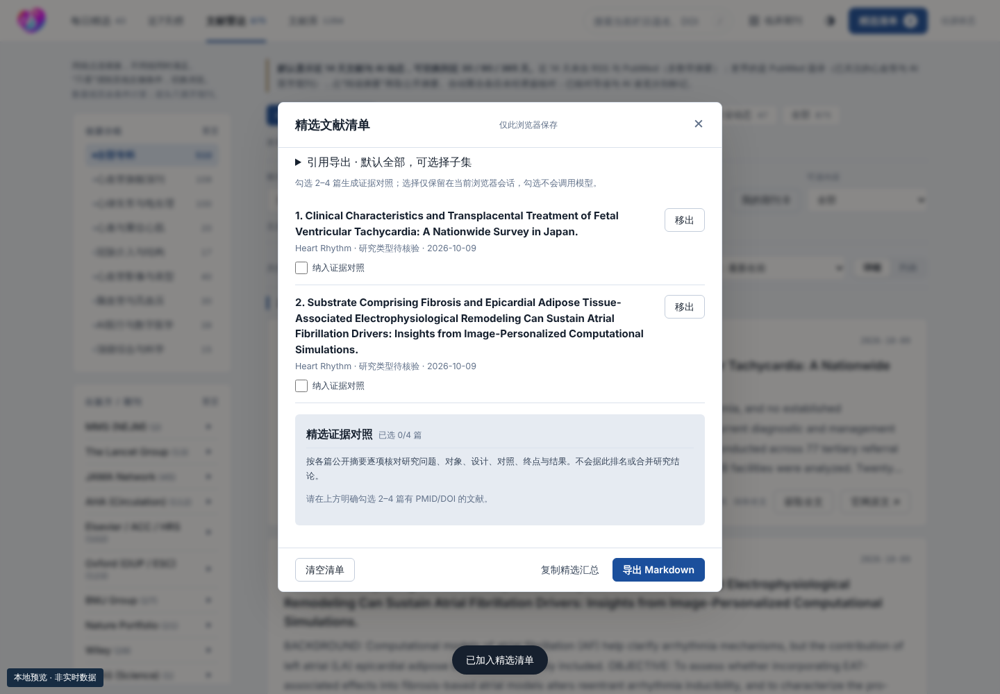
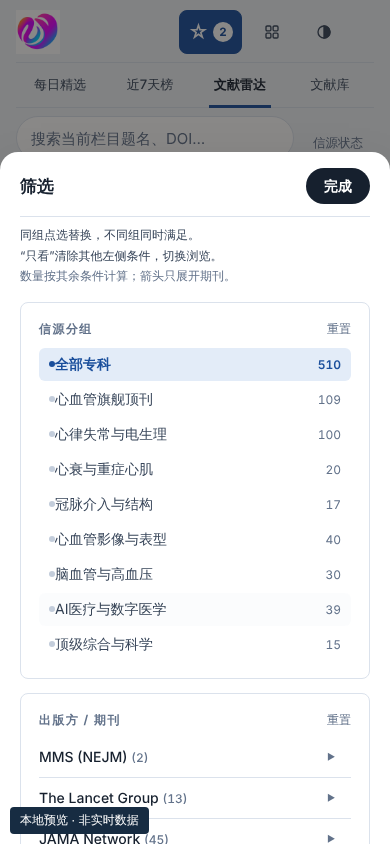

# 心知 · 网站使用说明手册

**心血管 × AI 医疗文献学习站**

- 网站：[https://learn.dryz.info/](https://learn.dryz.info/)
- 适用对象：日常阅读、文献查新及晨会准备的用户。
- 手册版本：1.2　｜　编制日期：2026 年 10 月 10 日（北京时间）。
- 格式：Markdown、HTML、PDF，三种格式正文一致。

> 本手册从 2026-10-07 对话中的完整正文恢复，并于 2026-10-10 对齐主分支 f3e0ff8；1.2 版按线上 v14.3.9 界面统一了栏目名（近7天榜、精选清单），并更新全文获取与下载路径。原截图文件未保存在本工作区，本版六张截图重新取自当前本地公开包预览；接口可用性采用关闭生成的模拟响应，不代表线上鉴权、全文任务或当前数据已验收。网站状态以实际显示和运行记录为准。

## 目录

1. [快速上手](#quickstart)
2. [认识网站与内容标记](#overview)
3. [每日精选：从导读开始](#curated)
4. [文献雷达与文献库：检索、筛选和关注](#search)
5. [阅读台：摘要、原文与引用](#reader)
6. [AI 辅助阅读：翻译、速览与研究结构](#ai)
7. [近7天榜：榜单、全文精读与示范](#weekly)
8. [精选清单：收集、对照、分享与导出](#huddle)
9. [手机使用、界面风格与快捷键](#mobile)
10. [信源状态与内容更新时间](#status)
11. [常见问题与处理方法](#faq)
12. [三个使用场景与手册文件说明](#scenarios)

## 1. 快速上手

### 1.1 第一次访问

1. 用浏览器打开 [learn.dryz.info](https://learn.dryz.info/)。公开阅读页面无需登录；首次加载请等待文献列表出现。
2. 首页进入“每日精选”。先看内容标记和日期，再选择一篇感兴趣的文献。
3. 点击“阅读导读与摘要”“阅读 AI 速览”或“阅读摘要”，打开右侧阅读台。
4. 先读中文导读或速览，再核对“公开摘要 · 原文”；需要全文时点击“前往官方原文”。
5. 有讨论价值的文献点击“加入精选清单”。打开右上方“精选清单”，可复制汇总或导出 Markdown。

**建议阅读顺序：选栏目 → 看标记 → 读原摘要 → 留精选清单 → 打开官方原文。**

### 1.2 按目的选入口

| 你想做什么 | 从哪里开始 | 接下来怎么做 |
| --- | --- | --- |
| 快速看近期值得关注的文章 | 每日精选 | 读导读，核对原摘要 |
| 查某个主题的新文献 | 文献雷达 | 选时间范围，输入关键词 |
| 查已有收录的旧文献 | 文献库 | 选“全部时间”，按题名、DOI 或 PMID 检索 |
| 准备一次文献研讨 | 精选清单 | 从各栏目收集文献，再复制或导出 |
| 查看完整的精读报告 | 近7天榜 | 先确认本周发布状态，再选期次 |

**使用前知道两件事：**网站帮助学习与查新；AI 结果、自动标签和引用草稿都需要回查来源。个人精选清单与关注期刊保存在当前浏览器，暂不跨设备同步。

## 2. 认识网站与内容标记

### 2.1 页面主要区域

顶部是四个栏目、搜索框、界面风格、深浅色切换和精选清单。栏目下方显示不同内容的更新时间。文献雷达与文献库还提供分类、时间范围、期刊和可读内容筛选；桌面端左侧有进一步筛选条件。内容区右上方有独立的“信源状态”入口。

*图 1：本地预览首页，用于定位导航、搜索和精选清单；截图中的日期与数量不代表实时数据。*

### 2.2 先认清标记，再判断阅读深度

| 页面标记或内容 | 表示什么 | 阅读时如何使用 |
| --- | --- | --- |
| 题录 / 自动聚合 | 题名、期刊、日期、DOI 等基础资料 | 用于发现文章，不表示已读全文 |
| 公开摘要 · 原文 | 来源数据库或期刊的公开摘要 | 作为核对导读、译文与 AI 要点的依据 |
| 机器翻译 | 模型生成的中文题名或摘要对照 | 术语、数字及结论回查英文原文 |
| AI 速览 / 自动精选 | AI 辅助速读或规则选出的文章 | 未经人工核验，不等于全文精读 |
| 摘要核对导读 | 已按标注范围核对公开摘要的中文导读 | 核对范围限于摘要，未经医生终审 |
| 全文精读 | 明确基于已取得全文编写的报告 | 查看期次、来源和审查范围；医生终审状态另看说明 |

“研究设计 · 自动判断”“研究类型待核验”、样本规模和效应量等自动提取信息用于辅助浏览。它们可能有误，不能代替论文方法和结果部分。“推荐”排序与榜单序号也不代表研究质量等级。

## 3. 每日精选：从导读开始

### 3.1 阅读一篇精选

1. 点击顶部“每日精选”。文章按精选或导读发布日期分组；分组日期可能不同于论文发表日期。
2. 用主题按钮缩小范围，或在顶部输入关键词。
3. 查看卡片上的期刊、研究设计、日期及“摘要核对”“自动精选”等标记。
4. 点击卡片的阅读按钮。已有导读时，阅读台会显示中文核心导读、证据边界和共读问题；具体内容以该篇实际提供的字段为准。
5. 向下查看原摘要；需要完整方法、图表和附录时打开官方原文。

### 3.2 分享与保存

有导读的文章可通过卡片“微信群文案”或阅读台“复制微信群文案”复制分享文字。复制后自行粘贴到微信或其他交流工具，网站不会自动发送消息。

“加入精选清单”适合暂存准备讨论的文章；保存的是当前浏览器中的文献清单，不是全文文件。再次点击已加入的按钮可取消，或在清单中点击“移出”。

### 3.3 没看到今天的新导读

自动查新、规则精选、AI 速览和摘要核对导读有各自的更新时间。查新更新不表示当天一定有新的人工核对导读。请看页面日期与内容标记，不把历史导读当成当天完成的精读。

## 4. 文献雷达与文献库：检索、筛选和关注

### 4.1 两个栏目如何选择

| 项目 | 文献雷达 | 文献库 |
| --- | --- | --- |
| 主要用途 | 追踪新文献及较近的历史题录 | 检索网站既有收录范围 |
| 时间选择 | 近 7 / 14 / 30 / 90 / 365 天 | 全部时间、近 30 / 90 / 365 天 |
| 初始范围 | 默认近 14 天 | 默认全部时间 |
| 阅读内容 | 摘要、导读或 AI 速览按实际可用情况显示 | 题录及可取得的公开摘要，不提供私人全文 PDF |

较早的雷达条目主要来自关注期刊的 PubMed 题录，通常要打开阅读台后再尝试获取摘要。365 天视图不代表覆盖所有来源、所有文章或所有全文。

*图 2：本地预览的雷达界面；分类、时间、期刊和可读内容条件可以叠加。*
### 4.2 搜索关键词
顶部搜索框对当前栏目及现有筛选范围内的文献进行检索。可输入中文关键词、英文题名片段、作者、期刊、DOI 或 PMID；只有已收录的字段能被命中。
- 查主题：输入 `房颤消融`、`心衰`、`大模型`。
- 查组合：输入 `房颤 消融`；以空格分隔的词需要同时匹配。
- 查具体论文：粘贴 DOI 编号，例如 `10.1038/s41591-025-03517-w`，或输入 PMID 数字。

中文检索会对部分医学词汇作英文扩展，但不是自然语言问答。若结果少，尝试英文关键词或较短词组。DOI 建议只粘贴编号，去掉网址前缀。

### 4.3 逐步筛选

1. 先选分类，例如“心血管 × AI”“心血管”“AI 医疗”或“全部”。默认的“心血管 + AI 医疗”并非所有来源。
2. 选择发表时间范围。“近 7 天”等按北京时间计算；只有刊期月份、缺少确切日期的条目可能不进入按天筛选。
3. 在“期刊 / 信源”下拉框选择来源。
4. 在“可读内容”中选“有公开摘要”“已核对导读”或“AI 速览（未核对）”。“有公开摘要”依据当前已有数据筛选，未显示的文章也可能在打开后取得摘要。
5. 需要时使用左侧“信源分组”“按出版方浏览”“研究设计”“主题标签”。手机端先点“筛选”。

结果为空时，依次清空搜索词、放宽分类与时间、取消期刊和“我的期刊”、将可读内容改为“全部”，再重置左侧条件。切换栏目后也应检查是否仍有其他筛选条件。

### 4.4 关注期刊、排序和显示更多

选择具体期刊后点击“☆ 关注期刊”。点击“我的期刊”仅查看自己关注的期刊，再次点击可取消限制。关注列表只存在当前浏览器，不会同步到同事或另一台设备。

排序可选“最新在前”“最早在前”“按期刊分组”或“推荐（导读/摘要优先）”。“详细”显示完整卡片，“列表”适合快速扫读；结果较多时点击页面下方“显示更多”。更正、来信等默认隐藏，可用“含更正 / 来信”按钮查看。

筛选后可以复制地址栏链接分享检索视图。链接不包含你的关注列表或精选清单；若分享时开启了“我的期刊”，接收者的结果仍受其自己的关注列表影响，建议先关闭该条件。

### 4.6 筛选与切换浏览（v14.3.1）

- 左侧各模块单选，同组点击新选项替换原选项，再次点击已选项保持选择；不同模块的条件需同时满足。例如选 Circulation 再选 RCT，会显示 Circulation 中的 RCT。
- 已有其他左侧条件时，选项旁会出现“只看”。点击“只看 RCT”会移除信源分组、期刊和主题等其他左侧条件，只保留 RCT；顶部领域、时间、关键词、可读内容及“我的期刊”条件保留。
- 出版方名称用于筛选该出版方，右侧箭头只展开或收起旗下期刊。顶部期刊下拉框与左侧期刊共享选择；换到另一出版方的期刊会同步更新所属出版方。
- 结果上方显示“当前筛选 · 同时满足”。点一个条件的 × 只移除该维度；期刊与出版方属于同一维度，清除期刊不会暗中保留出版方。“清空左侧筛选”保留顶部条件；“重置所有条件”恢复默认范围并清除关键词。
- 选项数量按其他条件计算，表示替换本组选项后的匹配篇数。零匹配选项仍可用“只看”切换浏览。组合无结果时，页面提供保留其中一项的实际篇数和按钮，不自动放宽条件。

## 5. 阅读台：摘要、原文与引用

### 5.1 打开和关闭

在文献卡片或列表行中点击阅读按钮，右侧打开“文献阅读台”。关闭可点击右上角“×”、背景遮罩或按 `Esc`；手机上阅读台会占据更大屏幕区域。

*图 3：本地预览的阅读台；内部可继续向下滚动，底部有精选清单与官方原文入口。*

### 5.2 推荐阅读顺序

1. **确认论文身份。**核对英文题名、期刊、发表日期、DOI / PMID；中文题名可能是机器翻译。
2. **读已有导读或速览。**看研究问题、主要发现和标注的局限。
3. **看“公开摘要 · 原文”。**结构化摘要可能按背景、方法、结果等分段；未取得摘要时页面会说明原因。
4. **核对关键数字。**“摘要自动提取的数字”可以展开，样本数、随访、效应量及显著性须与原摘要核对。
5. **打开官方原文。**需要全文、图表、补充材料或判断研究质量时，继续前往期刊或 PubMed。

“阅读这类研究要看什么”是按研究类型提供的通用阅读提示，不是对该篇论文已经完成的质量评价。

### 5.3 原文与引用草稿

阅读台底部有“前往官方原文”。题录区域还可能显示“DOI”“PubMed”入口。外部期刊全文可能需要机构订阅或个人权限；网站不公开私人 PDF。

在“题录引用草稿与原文入口”中可复制 GB/T 引用草稿、AMA 引用草稿或 BibTeX 题录。它们由已有字段生成，正式使用前应补全并核对作者、卷期、页码、文章号和 DOI；缺少字段不代表论文没有该信息。

### 5.6 全文下载与 Muse 协同

**按钮看状态：**文献卡片和阅读台的全文按钮会随状态变化。

| 卡片显示 | 含义 | 你要做的 |
| --- | --- | --- |
| 下载 PDF | 网站已核验全文 | 点击后输入全文口令，PDF 直接下载 |
| 获取全文 / 待补全文 | 站内还没有这篇全文 | 点击后输入全文口令提交请求，由 Muse 获取 |
| 全文排队中 / 全文获取中 / 已回传，等待核验 | 任务进行中 | 无需重复提交；点“查看任务”看进度 |
| 全文核验未通过 / 全文需人工处理 | 任务停在需要维护者的环节 | 无需重复提交，等待维护者处理 |

**完整路径：**

1. 在任意栏目点“获取全文”，或在搜索框粘贴 DOI 后点“获取全文”。新标签打开任务页，输入全文口令，点“提交全文请求”。
2. 任务页按步骤显示进度：待 Muse 领取 → Muse 获取全文 → 原件上传私有收件箱 → 网站核验 → 可下载。任务页每 60 秒刷新状态，不会重复下载，可以直接关闭。
3. 之后回到网站（原标签页重新获得焦点时会自动刷新状态），或在搜索框粘贴同一 DOI，卡片出现“下载 PDF”即可下载；任务页本身在可下载时也会直接显示口令框。
4. 任务页每个环节都有“回到网站查看这篇文献”的链接，回到的是该 DOI 的检索结果，而不是文献库首页。

Muse 领取时间取决于 Muse 运行安排，网站核验按每小时第 23 分钟计划执行，GitHub 实际调度常有延迟；整个过程可能需要数小时，不承诺即时。“已上传”或“待核验”不等于已可下载。核验未通过、登录失效或任务过期时，页面会标出停在哪一步；恢复入口仍需全文口令。口令只填网站表单，不会出现在链接中。网站可下载不代表 Mac/GitHub/正式 Drive 三端归档完成。

## 6. AI 辅助阅读：翻译、速览与研究结构

### 6.1 摘要翻译与一键解读

当相应服务开放且文献有可用标识时，页面会显示 AI 操作入口。

| 操作 | 在哪里点击 | 得到什么 |
| --- | --- | --- |
| 翻译摘要（中英对照） | 阅读台“公开摘要 · 原文”下方 | 与原摘要对照的中文译文 |
| 一键 AI 解读 | 尚无导读或速览的文献阅读台 | 基于公开摘要的中文速览及原句依据 |
| 只翻译标题 | 部分未找到摘要的文献阅读台 | 中文题名，不生成研究结论 |
| AI 综述本页前 N 篇 | 当前文献结果上方，符合条件时显示 | 当前排序靠前、具有 PMID / DOI 的最多 8 篇的摘要速读 |

点击生成后等待页面完成或显示错误，避免连续重复点击。页面估时通常为十几至几十秒，来源获取和服务状态可能使等待更长。已有结果可被其他读者复用，不代表已经人工核对。

**这些功能处理公开题名与摘要。**它们不代表读取了论文全文，也不是患者问题问答入口。AI 综述只处理当前结果中的部分文章，不等于对检索结果做了系统综述。

### 6.2 研究结构与全文核对（新增入口）

**仅在阅读台出现“研究结构与全文核对”区域后使用。**若当前线上页面没有该区域，可继续使用原摘要、阅读提示和官方原文入口。

1. 打开目标文献阅读台，滚动到“研究结构与全文核对”。页面先检查已有结果；这一步不会调用模型生成。
2. 有已有结果时直接阅读。若显示“提取研究结构与核对清单”，点击后才开始生成。
3. 逐项查看研究问题、研究对象、研究设计、干预与对照、研究终点、主要结果。
4. 展开“核对摘要原句”，确认各项中文内容对应的英文依据；查看摘要来源与生成时间。
5. 展开“全文核对清单（待查事项）”，带着问题阅读全文；可点击“复制研究结构与核对清单”保存。

“摘要未提供”表示该信息未在摘要中找到，不能理解为研究没有设置该环节。全文核对清单是待确认的问题，不能据此认定论文已经存在这些缺陷。原试验为 RCT，也不意味着其事后分析仍是新的随机试验。

### 6.3 生成失败或按钮不显示

按钮是否显示取决于上线版本、服务开放状态、文献标识及已有结果。无公开摘要时可能不生成；额度用尽、网络故障、服务配置或结果校验失败时也会停止。

按页面提示处理即可：稍后重试、次日再试或反馈维护者。结果提示“未保存”时不要把失败状态当成可用内容；仍可阅读已经取得的原摘要并打开官方原文。

## 7. 近7天榜：榜单、全文精读与示范

### 7.1 先看本周发布状态

点击顶部“近7天榜”，先读页面顶部的本周日期和发布状态。若写“全文精读尚未发布”，表示本周没有正式的新精读报告；下方榜单或旧示范不代表本周已经完成全文审查。

*图 4：本地预览的精读栏目；请区分本周状态、规则榜单与历史体例示范。*

### 7.2 三类内容分别使用

| 区域 | 作用 | 使用方法 |
| --- | --- | --- |
| 近 7 天文献榜 | 根据相关性、研究类型、期刊等规则帮助选题 | 读已取得的原摘要；AI 速览另看标记 |
| 精读期次 | 按期查看已发布的报告 | 核对期次日期与审查范围 |
| 全文精读体例示范 | 展示报告的写法和阅读结构 | 点击展开，按背景、AI 环节、设计、结果及局限阅读 |

榜单属于选题辅助，不是文献质量排名。“摘要待补充”表示当前尚未取得该摘要。示范论文的原始发表年和示范发布日期可能不同，应分别阅读标注。

有“下期候选”时，可点击“加入精选清单”表达讨论兴趣；进入候选不代表已经选定、已经评审或即将按固定日期发布。

### 7.4 每日 AI 全文精读

现有 GitHub Actions 每天北京时间 05:17 计划完整刷新，默认新增 4 篇、目标 3–5 篇；每两小时轻量刷新读取缓存。只使用可公开获取并核对身份的全文，显示实际日期、完成数量及不足原因。标记为“AI 全文精读 · 未经人工审核”，与历史示范或人工审核稿分开；目标不是每日完成保证。

GitHub 的定时任务常延迟数小时（例如 05:17 计划的完整刷新曾在 08:49 才启动）。当天批次尚未生成时，右栏会写明“今天的批次尚未生成”，下方显示最近一次批次。前一天核对未通过的全文不会在后续日期重复消耗生成额度。

## 8. 精选清单：收集、对照、分享与导出

### 8.1 收集与管理文献

1. 在卡片、列表、阅读台或下期候选中点击“加入精选清单”。顶部计数随选择变化。
2. 点击右上方“精选清单”，查看已加入文章的题名、期刊、研究设计与日期。
3. 不需要的文章点击“移出”；点击“清空清单”会立即移除当前全部选择，使用前建议先复制或导出。

*图 5：本地预览的清单；新版勾选框用于证据对照，底部用于复制汇总和导出。*

### 8.2 复制汇总和导出 Markdown

- **复制精选汇总：**点击后把文献列表和原文链接复制到剪贴板，再自行粘贴到群聊、邮件或笔记。
- **导出 Markdown：**清单非空时点击，下载 `精选文献清单-YYYY-MM-DD.md`；文件日期按北京时间生成。

导出包括已有题录、导读或摘要概要及相应证据边界、问题等字段，具体内容取决于该篇已经保存的数据。**常规清单导出不自动包含新生成的研究结构、证据对照表、摘要译文或 AI 讨论提纲。**这些内容需要用各自的复制按钮或手动选中保存；导出前建议打开文件检查实际内容。

### 8.3 AI 讨论提纲

清单中有至少 2 篇具有 PMID / DOI 的文献且 AI 服务开放时，可能显示“AI 生成讨论提纲”。点击后，系统按清单中符合条件的最多 8 篇公开摘要整理主题、逐篇要点、共同点与分歧及讨论问题。

讨论提纲未经人工核对，用于组织讨论。清单很多时不会一次处理全部文章；可先整理清单，再点击生成。

### 8.4 逐篇证据对照（新增入口）

**仅在清单中出现“纳入证据对照”勾选框和“精选证据对照”区域后使用。**

1. 先把目标文章加入清单，再明确勾选 2–4 篇有 PMID / DOI 的文献。勾选仅选中文献，不会调用模型生成。
2. 页面先读取这一组的已有结果；需要生成时点击“生成所选 N 篇证据对照”。
3. 逐列查看每篇的研究问题、对象、设计、干预与对照、终点、主要结果及摘要来源。
4. 展开各单元格“核对摘要原句”。手机端可横向滚动表格；没有摘要的文章会保留并说明原因。
5. 点击“复制证据对照与核对清单”，另行保存到研讨笔记。

不能重复选择同一论文；缺少标识的文章不能勾选。对照只并列展示各篇摘要证据，不做研究质量排名，不合并效应量，也不证明不同研究之间可以直接比较。

### 8.5 保存范围

精选清单保存在当前浏览器；证据对照的勾选仅保留在当前页面会话。更换设备、浏览器、使用无痕窗口或清理网站数据后，个人设置或清单可能不可见。需要交接给同事时，复制或导出具体材料。

## 9. 手机使用、界面风格与快捷键

### 9.1 手机上筛选与阅读

用手机浏览器直接访问同一网址。进入雷达或文献库，点击“筛选”打开筛选面板，选择条件后点击“完成”回到结果。阅读台与精选清单可上下滚动；多篇证据表可左右滚动。

*图 6：390 像素宽的本地手机预览；“完成”关闭筛选面板。*

### 9.2 调整阅读外观

顶部界面风格按钮可能显示当前风格名称。点击后可选择“临床期刊”“资讯榜单”“卡片杂志”或“纸感”。旁边的深浅色按钮切换深色与浅色；“详细 / 列表”调整文献显示密度。这些设置会尽可能记住在当前浏览器中，外观不同不改变文献的核对状态。

### 9.3 桌面快捷操作

| 操作 | 方法 |
| --- | --- |
| 快速进入网站搜索 | 按 `/` |
| 关闭阅读台、精选清单或筛选面板 | 按 `Esc` |
| 用键盘逐个访问控件 | 按 `Tab`，反向用 `Shift + Tab` |
| 在本手册中查找文字 | Windows / Linux 按 `Ctrl + F`，Mac 按 `Command + F` |

## 10. 信源状态与内容更新时间

### 10.1 查看更新时间

顶部更新时间分别反映查新、摘要核对导读、AI 速览等内容。应看对应项目的日期，不能仅根据页面刷新或网站能打开就判断每个栏目都是最新。

当前运营说明的计划为：每 2 小时轻量查新，每日北京时间 05:17 进行较完整的补充处理。实际任务可能延迟或失败，计划时间不保证当天一定产生新导读、成功的 AI 结果或新的全文精读；普通用户以页面记录为准。

### 10.2 看懂“信源状态”

点击内容区右上方“信源状态”，查看最近一次自动检查的时间、来源和抓取状态。返回主栏目可继续阅读。

| 状态 | 如何理解 |
| --- | --- |
| 获取成功 | 本次成功取得该来源数据 |
| 有效空源 / 近 14 天无新条目 | 获取成功但没有符合范围的新文章，不一定是故障 |
| 返回非订阅内容 / 订阅格式异常 | 来源响应与订阅格式不符，需要维护者排查 |
| 来源 HTTP 错误 / 获取异常 | 本次来源请求失败，不表示整个网站不可用 |
| 保留旧缓存 | 当前可能仍展示之前取得的有效资料，注意缓存日期 |
| 报告已过期 | 不能据旧报告判断当前来源是否可用 |

来源抓取正常不代表文章质量更高，也不代表 AI 服务正常。普通用户遇到问题可记录来源名称、时间和页面提示，反馈维护者。

## 11. 常见问题与处理方法

### 11.1 检索与阅读

| 现象 | 处理方法 |
| --- | --- |
| 搜索没有结果 | 先清空其他筛选，关闭“我的期刊”，扩大时间与分类；再试英文关键词、DOI 或 PMID。网站检索限于已收录资料 |
| 卡片有题名，阅读台没有摘要 | 等待来源获取；若提示未收录或获取失败，稍后重开或查看官方原文。题录存在不保证摘要或全文可用 |
| 没有更多文章显示 | 检查筛选条件和结果总数；页面底部有“显示更多”时继续加载 |
| 官方全文要求登录或付费 | 使用机构订阅、个人权限或论文公开版本；站内公开题录不包含全文访问权限 |
| 中文题名、研究类型或数字可疑 | 对照英文摘要和官方原文；标记为机器翻译或自动判断的内容可能有误 |
| 引用没有作者、卷期或页码 | 这是题录草稿，正式引用前从原文补全字段 |

### 11.2 AI 生成与个人设置

| 页面现象或提示 | 建议操作 |
| --- | --- |
| AI 按钮没有出现 | 确认是否存在相应功能区域和 PMID / DOI；功能也可能尚未上线或服务未开放 |
| 没找到公开摘要 | 直接读官方原文；若有“只翻译标题”可使用，但不会生成研究结论 |
| 正在生成 / 这篇正在被生成 | 等待后再查看，避免重复连续点击 |
| 今日额度或个人次数已达上限 | 阅读已有结果，按页面提示稍后或次日再试；服务额度日可能按 UTC 计算，与北京时间零点不同 |
| 网络错误、响应超时、暂时限流 | 稍后重试；持续失败时记录原文标识、操作时间及完整提示 |
| 服务认证失败、尚未配置或功能未开放 | 反馈维护者，普通用户无需更改服务配置 |
| 译文漏数、引文不符或格式校验失败 | 本次结果未保存；回查原摘要，必要时重试或反馈具体论文 |
| 换设备后关注或精选清单不见了 | 这些个人数据只存当前浏览器，使用复制或导出材料交接 |
| 复制或下载后没有找到内容 | 查看浏览器剪贴板权限与下载记录；可选中文本手动复制，导出前确认清单非空 |

### 11.3 向维护者反馈

建议一次写清：发生时间（北京时间）、设备与浏览器、所在栏目、论文题名及 DOI / PMID、点击的按钮、完整错误提示，以及脱敏截图。不要发送账号密码、密钥或患者资料。

可用格式：`2026-10-07 16:30，手机浏览器，文献雷达，PMID：……，点击“翻译摘要（中英对照）”后显示“……”。`

## 12. 三个使用场景与手册文件说明

### 12.1 查“房颤消融”近一周新文献

1. 进入“文献雷达”，选择“近 7 天”。
2. 分类选“心血管”，搜索 `房颤消融`；如想限定 AI 相关内容，可改选“心血管 × AI”。
3. 可读内容先保持“全部”，避免漏掉暂未取得摘要的题录。
4. 打开目标文章，阅读原摘要；将适合讨论的文章加入精选清单。
5. 数量较少时放宽至“近 14 天”或“近 30 天”，并检查其他筛选。

### 12.2 准备一次晨会研讨

1. 从精选、雷达或文献库收集主题相近的 2–4 篇文献。
2. 逐篇核对研究设计、对象、终点和原摘要，整理拟讨论的问题。
3. 新版对照入口可用时，明确勾选文献，生成逐篇证据对照并核对引文。
4. 用“复制精选汇总”分享题录与原文链接，用“导出 Markdown”保存常规清单。
5. 另用复制按钮保存证据对照与核对清单；需要完整结论时继续查阅各篇全文。

### 12.3 按 DOI 找回一篇旧论文

1. 进入“文献库”，选择“全部时间”。
2. 分类选“全部”，取消期刊及其他限制，输入 DOI 编号。
3. 打开阅读台，核对题名和来源；如果未命中，再到雷达扩大时间范围尝试。
4. 网站仍未收录时，可点结果区的“获取全文”提交请求（需全文口令，流程见 5.6），或直接使用期刊或 PubMed 检索；站内无结果不代表论文不存在。

### 12.4 如何使用这三种手册文件

| 文件 | 推荐用途 | 使用方式 |
| --- | --- | --- |
| 使用说明.md | 后续修改、版本管理及笔记导入 | 用 Markdown 阅读器打开；保持 `manual-assets` 图片文件夹与其相对位置一致 |
| 使用说明.html | 浏览器阅读、通过目录跳转及打印 | 双击打开，样式与截图已内嵌，可离线阅读手册；跳转网站及外部原文仍需联网 |
| 使用说明.pdf | 分发、打印与固定版式存档 | 用 PDF 阅读器打开，文字可检索，目录可跳转 |

需要转发含截图的 Markdown 时，建议使用完整压缩包；HTML 和 PDF 可以单独发送。后续网站按钮、布局或功能发生变化时，应更新 Markdown 正文并重新生成另两种格式。本手册中的截图不是网站实时状态证明。
